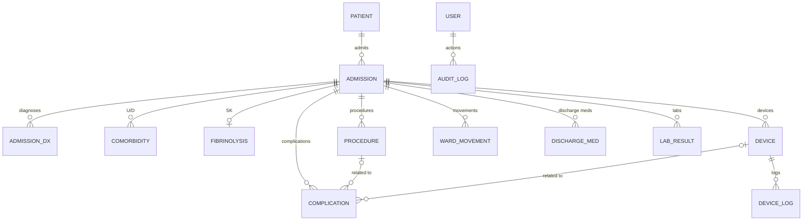
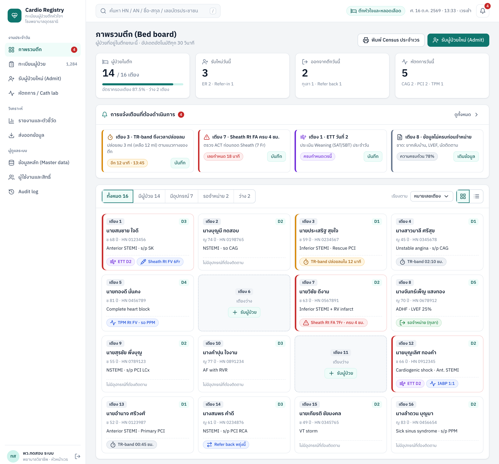
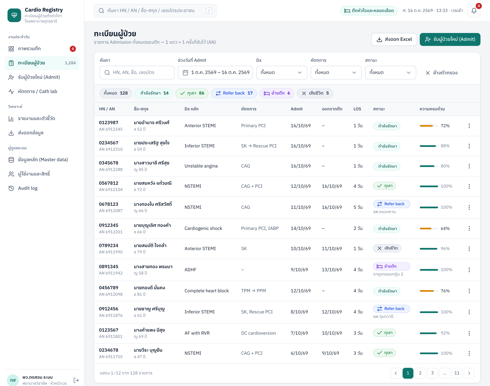
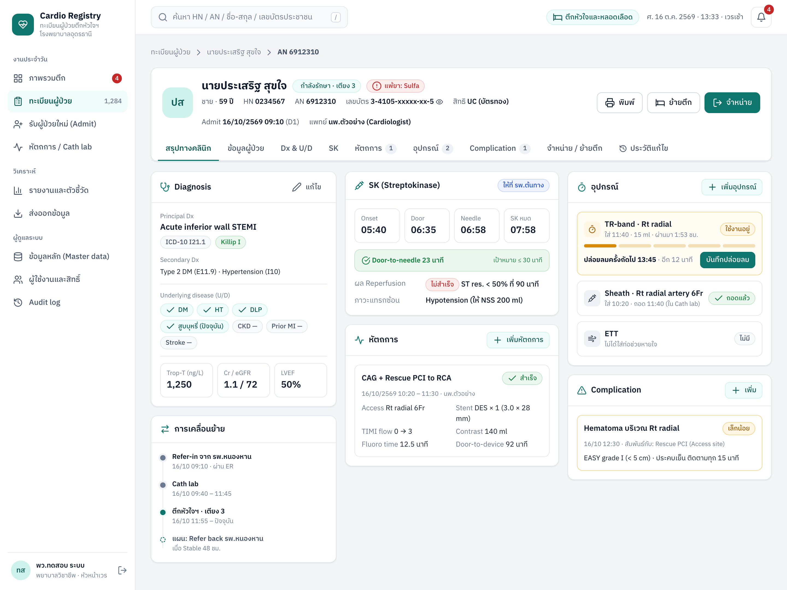
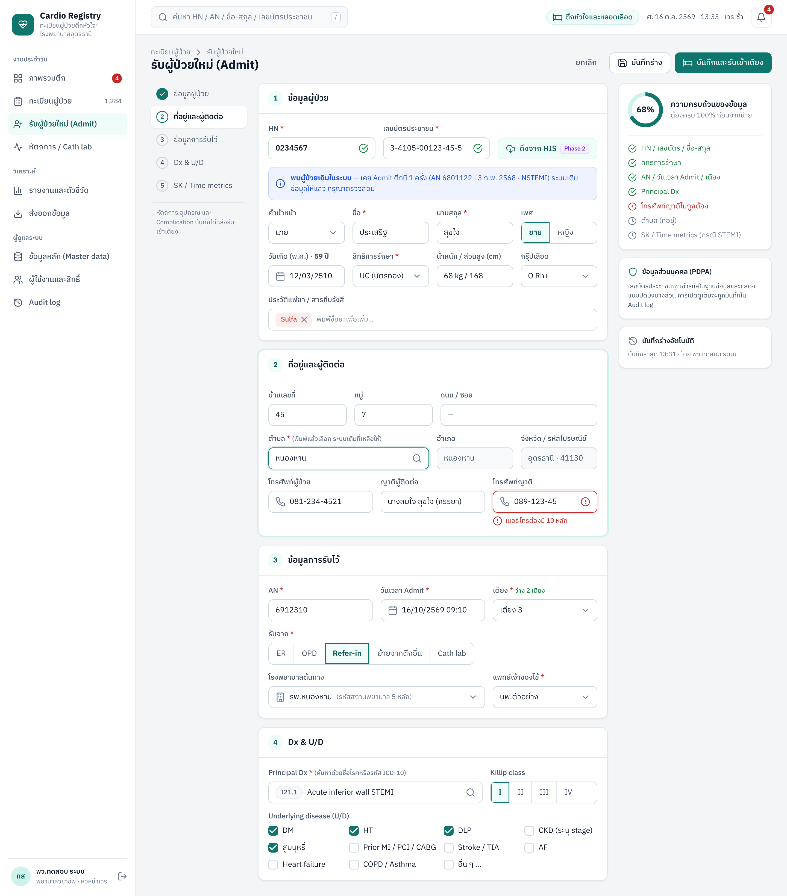
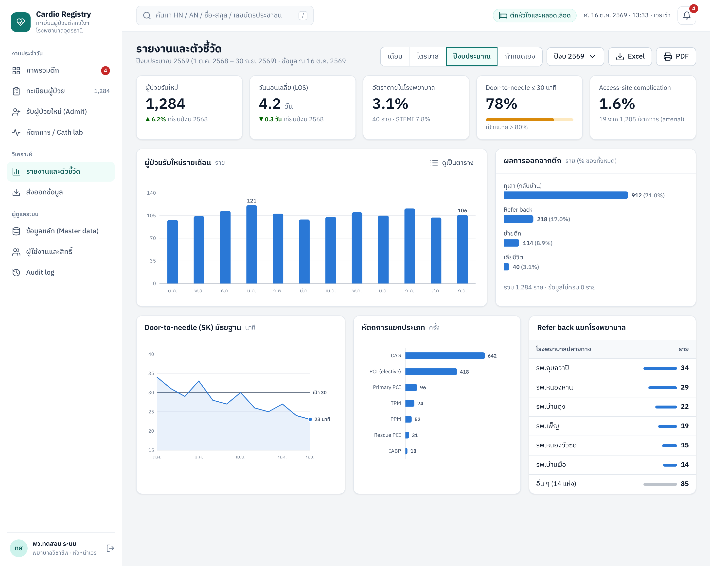
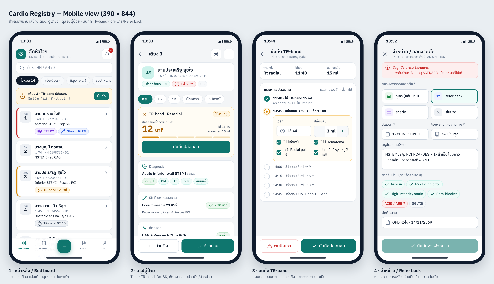

# ระบบทะเบียนผู้ป่วย ตึกหัวใจและหลอดเลือด โรงพยาบาลอุดรธานี — Project Planning

> **ชื่อระบบ (ชั่วคราว):** Cardio Registry · **เวอร์ชันเอกสาร:** 0.1 (ร่างเพื่อทบทวน) · **วันที่:** 16 ต.ค. 2569
> ข้อมูลผู้ป่วยในภาพ mockup ทุกภาพเป็น **ข้อมูลสมมติ**

## สารบัญ

1. [Overview](#1-overview)
2. [วิเคราะห์ข้อมูลเดิมและสิ่งที่ควรเพิ่ม](#2-วิเคราะห์ข้อมูลเดิมและสิ่งที่ควรเพิ่ม)
3. [Tech Stack และสถาปัตยกรรม](#3-tech-stack-และสถาปัตยกรรม)
4. [Data Model](#4-data-model)
5. [ฟีเจอร์และโครงสร้างหน้าจอ](#5-ฟีเจอร์และโครงสร้างหน้าจอ)
6. [UX/UI (Desktop / Mobile)](#6-uxui-desktop--mobile)
7. [แผนงาน (Work Breakdown)](#7-แผนงาน-work-breakdown)
8. [Non-functional Requirements, Security และ PDPA](#8-non-functional-requirements-security-และ-pdpa)
9. [ความเสี่ยงและแนวทางรับมือ](#9-ความเสี่ยงและแนวทางรับมือ)
10. [Definition of Done และ Go-live Checklist](#10-definition-of-done-และ-go-live-checklist)
11. [ขั้นตอนถัดไป](#11-ขั้นตอนถัดไป)

---

## 1. Overview

### 1.1 ที่มาและปัญหา

> **หมายเหตุ:** สถานการณ์ปัจจุบันด้านล่างเป็น *สมมติฐาน* ที่ต้องยืนยันกับหน้างานใน Phase 0

ตึกหัวใจและหลอดเลือดบันทึกทะเบียนผู้ป่วยในสมุดหรือ Excel ซึ่งทำให้เกิดปัญหาเหล่านี้

- **ข้อมูลซ้ำและไม่ครบ** ผู้ป่วยรายเดิมที่กลับมา Admit ต้องกรอกข้อมูลใหม่ทั้งหมด และไม่เห็นประวัติครั้งก่อน
- **ค้นหาย้อนหลังยาก** การหาผู้ป่วยจาก HN, AN, ชื่อ หรือเลขบัตรต้องเปิดไล่ทีละหน้า
- **ทำรายงานช้า** ตัวชี้วัดรายเดือน (จำนวนหัตถการ อัตราตาย Door-to-needle) ต้องนับเอง
- **ติดตามอุปกรณ์ด้วยความจำ** เวลาปล่อยลม TR-band เวลาถอด Sheath และจำนวนวันใส่ ETT ไม่มีระบบเตือน จึงเสี่ยงต่อ complication
- **ข้อความอิสระ** เช่น Dx, U/D และ Complication สะกดได้หลายแบบ ทำให้นับสถิติไม่ได้

### 1.2 เป้าหมาย

1. มีทะเบียนผู้ป่วยกลางของตึก ที่ค้นหาได้ภายในไม่กี่วินาที
2. บันทึกข้อมูลคลินิกที่สำคัญเป็นโครงสร้าง ได้แก่ Dx, U/D, SK, หัตถการ, อุปกรณ์, Complication, การจำหน่าย และการย้ายตึก
3. ติดตามอุปกรณ์แบบ real-time และแจ้งเตือนเมื่อถึงเวลาต้องทำ
4. ได้รายงานและตัวชี้วัดอัตโนมัติ พร้อมส่งออก Excel
5. ปกป้องข้อมูลส่วนบุคคลตาม พ.ร.บ.คุ้มครองข้อมูลส่วนบุคคล (PDPA)

### 1.3 ขอบเขต

| อยู่ในขอบเขต (v1) | อยู่นอกขอบเขต v1 (ย้ายไป Phase ถัดไป) |
|---|---|
| ทะเบียนผู้ป่วยและการ Admit (HN/AN) | เชื่อมต่อ HIS อัตโนมัติ (v1 ใช้กรอกเอง หรือ import) |
| Dx, U/D, SK/Time metrics, Lab สำคัญ | Order ยา / ใบสั่งแพทย์ / EMR เต็มรูปแบบ |
| หัตถการ, อุปกรณ์ (ETT/TR-band/Sheath/TPM/IABP), Complication | ระบบ Cath lab reporting เต็มรูปแบบ (ภาพ angiogram) |
| จำหน่าย, Refer back, ย้ายตึก | ระบบนัดหมาย OPD |
| Bed board และการแจ้งเตือนภายในแอป | แจ้งเตือนผ่าน LINE หรือ SMS |
| รายงาน/KPI และส่งออก Excel | ส่งข้อมูลเข้า Registry ระดับประเทศอัตโนมัติ |
| ผู้ใช้ สิทธิ์ และ Audit log | Single sign-on ของโรงพยาบาล (ทำได้ภายหลังถ้ามี AD/LDAP) |
| Import ข้อมูลเก่าจาก Excel | — |

### 1.4 ผู้ใช้งานและสิทธิ์

| สิทธิ์ | พยาบาล | หัวหน้าตึก | แพทย์ | QA / เวชสถิติ | Admin (IT) |
|---|:-:|:-:|:-:|:-:|:-:|
| ดู Bed board / ทะเบียน | ✓ | ✓ | ✓ | ✓ | – |
| Admit / แก้ไขข้อมูลผู้ป่วย | ✓ | ✓ | ✓ | – | – |
| บันทึก Dx, SK, หัตถการ, อุปกรณ์, Complication | ✓ | ✓ | ✓ | – | – |
| จำหน่าย / ย้ายตึก | ✓ | ✓ | ✓ | – | – |
| อนุมัติจำหน่ายแม้ข้อมูลไม่ครบ (Override + เหตุผล) | – | ✓ | ✓ | – | – |
| เปิดดูเลขบัตรประชาชนเต็ม (บันทึก log ทุกครั้ง) | ✓ | ✓ | ✓ | – | – |
| รายงาน / ส่งออก Excel | – | ✓ | ✓ | ✓ (ไม่ระบุตัวตน) | – |
| จัดการ Master data | – | ✓ | – | – | ✓ |
| จัดการผู้ใช้ / ดู Audit log | – | ดูได้ | – | – | ✓ |

### 1.5 ตัวชี้วัดความสำเร็จของโครงการ

- ผู้ป่วยที่ Admit เข้าตึกถูกบันทึกในระบบ **≥ 95%** ภายในเดือนที่ 2 หลัง Go-live
- ข้อมูลครบถ้วน (completeness) เฉลี่ย **≥ 90%** ณ เวลาจำหน่าย
- เวลาทำรายงานประจำเดือนลดจากหลายชั่วโมงเหลือ **< 10 นาที**
- พยาบาลบันทึก Admit ใหม่ได้ใน **≤ 3 นาที** และบันทึก TR-band ได้ใน **≤ 30 วินาที**
- ไม่มีเหตุการณ์ข้อมูลรั่วไหล และ Audit log ครบ 100%

---

## 2. วิเคราะห์ข้อมูลเดิมและสิ่งที่ควรเพิ่ม

### 2.1 ประเด็นที่สำคัญที่สุด: แยก "ผู้ป่วย" ออกจาก "การ Admit"

ข้อมูลเดิมรวม HN และ AN ไว้ในแถวเดียวกัน แต่ **HN คือคน (ถาวร)** ส่วน **AN คือการนอนโรงพยาบาลแต่ละครั้ง** ผู้ป่วยหัวใจมักกลับมา Admit ซ้ำ ดังนั้นต้องแยกตาราง

```
ผู้ป่วย (HN) ──1:N──> การ Admit (AN) ──1:N──> หัตถการ
  ชื่อ, เลขบัตร,                          ──1:N──> อุปกรณ์ (ETT / TR-band / Sheath …)
  ที่อยู่, สิทธิ, แพ้ยา                     ──1:N──> Complication
                                          ──1:N──> การย้ายตึก
                                          ──1:1──> SK / Time metrics, การจำหน่าย
```

ผลที่ได้คือ Admit ซ้ำไม่ต้องกรอกข้อมูลส่วนตัวใหม่ เห็นประวัติทุกครั้ง และวิเคราะห์ Readmission ได้

อีกประเด็นหนึ่งคือ **"ออกจากตึก" ไม่เท่ากับ "จำหน่ายจากโรงพยาบาล"** ถ้าผู้ป่วยย้ายไปตึกอื่น การดูแลในตึกนี้จบลงด้วยสถานะ "ย้ายตึก" ส่วนผลจำหน่ายสุดท้ายจะเกิดที่ตึกปลายทาง ระบบจึงเก็บ **สถานะออกจากตึก** เป็นหลัก และอาจเติมผลสุดท้ายจากโรงพยาบาลภายหลังได้ (Phase 2 ผ่าน HIS)

### 2.2 วิเคราะห์ฟิลด์เดิมทีละรายการ

| ฟิลด์เดิม | ความหมาย / การตีความ | ปัญหาถ้าเก็บแบบเดิม | ข้อเสนอการเก็บข้อมูล |
|---|---|---|---|
| ชื่อ-นามสกุล | ชื่อผู้ป่วย | ช่องเดียว ค้นหาและเรียงยาก คำนำหน้าปนกับชื่อ | แยก คำนำหน้า / ชื่อ / นามสกุล และค้นหาแบบ fuzzy ได้ |
| HN | รหัสผู้ป่วยของโรงพยาบาล | — | Unique ระดับผู้ป่วย ตรวจรูปแบบตาม HIS |
| AN | รหัสการ Admit แต่ละครั้ง | อยู่แถวเดียวกับ HN ทำให้ Admit ซ้ำต้องกรอกใหม่ | Unique ระดับ Admission (1 HN มีหลาย AN) |
| เลขประชาชน | 13 หลัก | พิมพ์ผิดได้ และเป็นข้อมูลอ่อนไหว | ตรวจ checksum หลักที่ 13 · **เข้ารหัสในฐานข้อมูล** และแสดงแบบปิดบัง (`3-4105-xxxxx-xx-5`) · รองรับต่างด้าว/ไม่มีเลข (Passport หรือเลขต่างด้าว) |
| ที่อยู่ | ที่อยู่ผู้ป่วย | ข้อความเดียว วิเคราะห์พื้นที่ไม่ได้ | บ้านเลขที่ / หมู่ / ถนน + **เลือกตำบลแล้วเติมอำเภอ จังหวัด รหัสไปรษณีย์ให้อัตโนมัติ** ใช้ดูว่าผู้ป่วยมาจากอำเภอใดและควร Refer back ไปที่ใด |
| Dx | การวินิจฉัย | พิมพ์อิสระ สะกดหลายแบบ นับไม่ได้ | Principal Dx + Secondary Dx จากรายการมาตรฐาน (ICD-10 กลุ่มโรคหัวใจ) + **Killip class** + ชนิด ACS (STEMI ระบุผนัง / NSTEMI / UA) |
| U/D | โรคประจำตัว | พิมพ์อิสระ | Checklist: DM, HT, DLP, CKD (stage/eGFR), สูบบุหรี่, Prior MI/PCI/CABG, Stroke/TIA, AF, HF, COPD + อื่นๆ |
| SK | Streptokinase (ยาละลายลิ่มเลือด) | ถ้าเก็บแค่ "ให้/ไม่ให้" จะคำนวณ Door-to-needle ไม่ได้ | ให้/ไม่ให้ (+เหตุผลที่ไม่ให้) · **สถานที่ให้** (รพ.ต้นทาง / ER / ตึก) · เวลา Onset, Door, Needle, สิ้นสุด · ผล Reperfusion · ภาวะแทรกซ้อน (Hypotension, Bleeding, Allergy) · รองรับยาตัวอื่นในอนาคต |
| ETT | **Endotracheal tube** (ตีความ ต้องยืนยัน) | ไม่รู้ว่าใส่กี่วัน | วันเวลาใส่/ถอด, ขนาด, สถานที่ใส่, Re-intubation, Unplanned extubation → คำนวณ **Ventilator days** |
| TR-band | อุปกรณ์กดห้ามเลือดหลังเจาะ Radial | ไม่มีการติดตามเวลา | ตำแหน่ง, เวลาใส่, ปริมาตรลมเริ่มต้น, **log การปล่อยลมแต่ละครั้ง + การประเมิน**, เวลาถอด, ภาวะแทรกซ้อน |
| Sheath | ท่อเปิดหลอดเลือด | ไม่รู้ว่าคาไว้นานเท่าไร | ตำแหน่ง (Rt/Lt Femoral A/V, Radial), ขนาด Fr, เวลาใส่/ถอด, **ACT ก่อนถอด**, วิธีห้ามเลือด (Manual / Closure device), ผู้ถอด |
| หัตถการ | CAG, PCI, TPM ฯลฯ | 1 Admission มีหลายหัตถการ แต่มีช่องเดียว | ตารางแยก (1:N) เลือกจาก master list + วันเวลา, ผู้ทำ, Access, รายละเอียด |
| ผลการรักษา | — | ข้อความอิสระ ปนระหว่างผลหัตถการกับผลรวม | แยกเป็น (1) **ผลหัตถการ** สำเร็จ/ไม่สำเร็จ, TIMI flow ก่อน-หลัง และ (2) **สรุปผลการรักษา** ตอนจำหน่าย |
| Complication | ภาวะแทรกซ้อน | ไม่รู้ว่าเกิดจากอะไรและเมื่อไร | ตาราง 1:N เลือกจาก master list + เวลา + ความรุนแรง (BARC สำหรับ bleeding, EASY สำหรับ radial hematoma) + **ผูกกับหัตถการหรืออุปกรณ์ที่เกี่ยวข้อง** |
| การจำหน่าย | ทุเลา / Refer back / เสียชีวิต | ขาดกรณี "ไม่สมัครใจอยู่" และ "ย้ายตึก" | สถานะออกจากตึก: **ทุเลา / Refer back (+รพ.ปลายทาง) / ย้ายตึก / เสียชีวิต (+เวลา, สาเหตุ) / ไม่สมัครใจอยู่** · map กับรหัสมาตรฐาน 43 แฟ้ม (แฟ้ม ADMISSION) เพื่อส่งออก |
| ย้ายตึก | การเคลื่อนย้าย | ย้ายได้หลายครั้ง แต่มีช่องเดียว | ตาราง **Movement log** (จาก → ไป, เวลา, เหตุผล, เตียง) ทั้งย้ายเข้าและย้ายออก |

### 2.3 ข้อมูลที่ควรเพิ่ม

ระดับความสำคัญ: **Must** = ต้องมีใน v1 · **Should** = ควรมีใน v1 · **Could** = ทำภายหลังได้

| กลุ่ม | ข้อมูลที่เพิ่ม | เหตุผล | ระดับ |
|---|---|---|---|
| ผู้ป่วย | เพศ, วันเกิด (คำนวณอายุอัตโนมัติ), เบอร์โทร, ญาติผู้ติดต่อ + เบอร์ | ติดต่อญาติ ใช้แยกกลุ่มในรายงาน | Must |
| ผู้ป่วย | **ประวัติแพ้ยา / สารทึบรังสี** | ความปลอดภัยของผู้ป่วยก่อนทำ CAG/PCI | Must |
| ผู้ป่วย | **สิทธิการรักษา** (UC, ข้าราชการ, ประกันสังคม, อื่นๆ) | ใช้ประสานการ Refer และเบิกจ่าย | Must |
| ผู้ป่วย | น้ำหนัก / ส่วนสูง, กรุ๊ปเลือด | คำนวณขนาดยาและปริมาณสารทึบรังสี | Should |
| Admission | วันเวลา Admit, รับจาก (ER / OPD / Refer-in / ย้ายจากตึกอื่น / Cath lab), **รพ.ต้นทาง (รหัสสถานพยาบาล 5 หลัก)**, เตียง, แพทย์เจ้าของไข้ | เป็นพื้นฐานของ Bed board และรายงานเครือข่าย Refer | Must |
| Time metrics | Onset, First medical contact, Door, Needle, Device (balloon) → **Door-to-needle, Door-to-balloon, Total ischemic time** | ตัวชี้วัดคุณภาพการรักษา STEMI | Should |
| Lab | Troponin, Cr/eGFR (ก่อน-หลังฉีดสี เพื่อดู CI-AKI), LVEF, Hb, K | ใช้ประเมินความเสี่ยงและภาวะแทรกซ้อน | Should |
| หัตถการ | ผู้ทำ, Access site, ขนาด Sheath, Vessel, Stent (ชนิด/จำนวน/ขนาด), TIMI ก่อน-หลัง, ปริมาณ Contrast, Fluoroscopy time | สถิติหัตถการและคุณภาพ | Should |
| อุปกรณ์อื่น | TPM wire, IABP, CVC, A-line, Foley | นับ device-days เพื่อเฝ้าระวัง VAP / CLABSI / CAUTI | Could |
| จำหน่าย | **ยากลับบ้าน** (Aspirin, P2Y12 inhibitor, Statin, Beta-blocker, ACEI/ARB/ARNI, SGLT2i) + เหตุผลถ้าไม่ให้ | ตัวชี้วัดการรักษาตามแนวทางเวชปฏิบัติใน ACS | Should |
| จำหน่าย | นัดติดตาม, สรุปผลการรักษา, สาเหตุการเสียชีวิต | ความต่อเนื่องของการดูแล | Should |
| การพยาบาล | Fall, Pressure injury, Unplanned extubation, Phlebitis | ตัวชี้วัดคุณภาพการพยาบาล | Could |
| ระบบ | ผู้บันทึก/ผู้แก้ไข + เวลา, **Audit log**, % ความครบถ้วน, ลบแบบ soft delete | ตรวจสอบย้อนหลังได้ และเป็นไปตาม PDPA | Must |

### 2.4 ฟีเจอร์ระบบที่ควรเพิ่ม (นอกเหนือจากการเก็บข้อมูล)

1. **Bed board** แสดงเตียงทั้งหมด ผู้ป่วย วันนอน และอุปกรณ์ที่กำลังใช้ ในหน้าเดียว
2. **ติดตามอุปกรณ์และแจ้งเตือน** เช่น เวลาปล่อยลม TR-band ตามแนวทางของตึก (ตั้งค่าได้), Sheath คาไว้ครบ X ชั่วโมง, ETT วันที่ N ให้ประเมิน weaning
3. **ตรวจความครบถ้วนก่อนจำหน่าย** ถ้ายังมีอุปกรณ์ไม่ได้ถอดหรือข้อมูลบังคับไม่ครบ ระบบจะไม่ให้จำหน่าย ยกเว้นหัวหน้าตึกหรือแพทย์ override พร้อมระบุเหตุผล
4. **ค้นหาเร็วและตรวจข้อมูลซ้ำ** เมื่อพิมพ์ HN หรือเลขบัตรที่มีอยู่แล้ว ระบบจะเสนอใช้ข้อมูลผู้ป่วยเดิม
5. **ประวัติข้าม Admission** และแจ้งเตือน Readmission ภายใน 28 วัน (ใช้นิยามของโรงพยาบาล)
6. **รายงานและ KPI** อัตโนมัติ ส่งออก Excel และพิมพ์ PDF
7. **พิมพ์ Census ประจำเวร** หรือใบสรุปส่งเวร
8. **จัดการ Master data** (หัตถการ, Complication, Dx, โรงพยาบาลในเครือข่าย, เตียง) ได้เองโดยไม่ต้องแก้โค้ด
9. **Audit log** บันทึกทุกการเพิ่ม/แก้/ลบ การเปิดดูเลขบัตรเต็ม และการส่งออกข้อมูล
10. **Import ข้อมูลเก่าจาก Excel** พร้อมรายงานแถวที่มีปัญหา
11. *(Phase 2)* ดึงข้อมูลจาก HIS ด้วย HN, ส่งออกตามรูปแบบ Registry ระดับประเทศ, แจ้งเตือนผ่าน LINE OA โดยไม่ส่งข้อมูลระบุตัวตน

### 2.5 คำถามที่ต้องยืนยันกับหน้างาน (Phase 0)

| # | คำถาม | ผลกระทบถ้าตอบต่างจากสมมติฐาน |
|---|---|---|
| 1 | **ETT** หมายถึง Endotracheal tube หรือ Exercise Treadmill Test | ถ้าเป็น Treadmill ต้องเปลี่ยนฟิลด์เป็นผลการทดสอบแทนการนับวันใส่ท่อ |
| 2 | **SK** ยังใช้ Streptokinase อย่างเดียว หรือมียาละลายลิ่มเลือดตัวอื่นด้วย | ถ้ามีหลายตัว ต้องเพิ่ม dropdown ชื่อยา (โครงสร้างรองรับไว้แล้ว) |
| 3 | ตึกมีกี่เตียง แบ่งโซน CCU / Step-down หรือไม่ | ส่งผลต่อ Bed board และอัตราครองเตียง |
| 4 | แนวทางปล่อยลม TR-band และเกณฑ์ถอด Sheath ของตึก | ใช้ตั้งค่าเริ่มต้นของ protocol และการแจ้งเตือน |
| 5 | HIS ที่ใช้คืออะไร มี API หรือ read-only DB ให้หรือไม่ | กำหนดว่าจะเชื่อม HIS ได้เมื่อไร |
| 6 | มี server/VM ภายในโรงพยาบาลให้หรือไม่ และ Wi-Fi ครอบคลุมตึกหรือไม่ | ส่งผลต่อ deploy และการใช้งานบนมือถือ |
| 7 | รายงานที่ต้องส่งจริง (ตัวชี้วัดกระทรวง/เขต, ทีมนำทางคลินิก) และนิยามสูตร | กำหนดหน้ารายงานและ export |
| 8 | ข้อมูลเก่าใน Excel มีกี่ปี และรูปแบบเป็นอย่างไร | กำหนดขอบเขตงาน migration |
| 9 | ใครเป็นผู้ดูแลระบบระยะยาว (IT โรงพยาบาลหรือทีมภายนอก) | อาจต้องปรับ tech stack ให้ตรงกับทักษะทีม |

---

## 3. Tech Stack และสถาปัตยกรรม

### 3.1 หลักการเลือก

1. **ข้อมูลต้องอยู่ในโรงพยาบาล (on-premise)** ข้อมูลสุขภาพเป็นข้อมูลอ่อนไหวตาม PDPA จึงไม่ใช้บริการ cloud ภายนอกเก็บข้อมูลผู้ป่วยหรือยืนยันตัวตน
2. **ทีมเล็กดูแลได้** ใช้ภาษาเดียวทั้งระบบ (TypeScript) เป็นแอปเดียว (monolith) และ deploy ด้วย Docker
3. **ใช้ได้ทั้ง Desktop และมือถือ** ด้วย Responsive web + PWA โดยไม่ต้องทำแอปแยก
4. **เทคโนโลยีมาตรฐานที่หาคนดูแลได้ง่าย**

### 3.2 Stack ที่เสนอ

| Layer | เลือกใช้ | เหตุผล |
|---|---|---|
| ภาษา | TypeScript | ภาษาเดียวทั้ง frontend/backend และ type-safe |
| Web framework | **Next.js (App Router) + React** | UI และ API (Server Actions / Route Handlers) อยู่ในโปรเจกต์เดียว |
| UI | **Tailwind CSS + shadcn/ui** (Radix) | component พร้อมใช้ รองรับ accessibility และปรับธีมง่าย |
| ฟอนต์ | IBM Plex Sans Thai (self-host) | ภาษาไทยอ่านง่าย ตัวเลขชัด และ self-host เพราะบางเครื่องออกอินเทอร์เน็ตไม่ได้ |
| ฟอร์มและ validation | React Hook Form + **Zod** | schema เดียวใช้ได้ทั้ง client และ server (เช่น ตรวจเลขบัตร) |
| ตาราง | TanStack Table | ใช้กับหน้าทะเบียน: filter/sort/pagination ฝั่ง server |
| กราฟ | Recharts | กราฟในหน้ารายงาน มี tooltip และมุมมองตาราง |
| ฐานข้อมูล | **PostgreSQL 16+** | relational และ transaction ครบ มี `pg_trgm` ค้นหาชื่อไทยแบบ fuzzy |
| ORM | Prisma | schema และ migration ชัดเจน |
| Authentication | Auth.js (Credentials) + argon2 · รองรับ LDAP/AD ภายหลัง | บัญชีอยู่ในระบบของโรงพยาบาลเอง |
| Authorization | RBAC ตรวจทั้งที่ middleware และในทุก server action | ป้องกันการเรียก API ตรง |
| ส่งออก | ExcelJS (.xlsx) · Print CSS สำหรับ PDF | รายงานและ Census |
| Realtime | Polling ทุก 30 วินาที (v1) และค่อยเปลี่ยนเป็น SSE ถ้าจำเป็น | ง่ายและเพียงพอสำหรับ 16 เตียง |
| PWA | Serwist | ติดตั้งบนมือถือ/แท็บเล็ตได้ **ไม่ cache ข้อมูลผู้ป่วยไว้ offline** |
| Deploy | **Docker Compose** (app + postgres + nginx/HTTPS) บน Linux VM ในโรงพยาบาล | IT ดูแลได้ และย้ายเครื่องง่าย |
| Backup | `pg_dump` รายวันแบบเข้ารหัส เก็บที่ NAS อีกเครื่อง + WAL archiving (ถ้าต้องการ RPO ต่ำ) | กู้คืนได้ และทดสอบ restore ทุกเดือน |
| Testing | Vitest (unit) + Playwright (E2E) | ทดสอบ validator, สูตร KPI และ flow หลัก |
| CI | GitHub Actions หรือ GitLab CI ของโรงพยาบาล | lint → typecheck → test → build image |
| Logging / Monitoring | pino + logrotate, Uptime Kuma | ตรวจได้ว่าระบบล่มหรือช้า |

> **ทางเลือก:** ถ้าทีม IT ของโรงพยาบาลถนัด PHP/Laravel + MySQL (พบบ่อยในโรงพยาบาลที่ใช้ HOSxP) Data model, หน้าจอ และแผนงานในเอกสารนี้ใช้ได้เหมือนเดิม ให้ตัดสินใจใน Phase 0 ตามผู้ดูแลระบบระยะยาว (คำถามข้อ 9)

### 3.3 สถาปัตยกรรม

```
 [PC Nurse station / ห้องแพทย์]      [มือถือ / แท็บเล็ต ผ่าน Wi-Fi รพ.]
              │      HTTPS (เครือข่ายภายใน)      │
              └───────────────┬──────────────────┘
                        ┌─────▼─────┐
                        │   Nginx   │  TLS, rate limit, security headers
                        └─────┬─────┘
             ┌────────────────▼─────────────────┐
             │        Next.js App (Node.js)      │
             │  UI · Server Actions · REST API   │
             │  Auth · RBAC · Audit · Alerts     │
             └──────┬───────────────────┬────────┘
                    │                   │  (Phase 2 · read-only)
             ┌──────▼──────┐     ┌──────▼───────┐
             │ PostgreSQL  │     │  HIS ของ รพ.  │
             └──────┬──────┘     └──────────────┘
             ┌──────▼──────┐
             │ Backup / NAS│  pg_dump รายวันแบบเข้ารหัส
             └─────────────┘
```

### 3.4 โครงสร้างโปรเจกต์ (เบื้องต้น)

```
ccu/
├── app/                    # Next.js routes (UI + server actions)
│   ├── (auth)/login
│   ├── (app)/beds          # Bed board
│   ├── (app)/patients      # ทะเบียน + Admit
│   ├── (app)/admissions/[an]
│   ├── (app)/reports
│   └── (app)/admin
├── components/             # UI components (shadcn/ui)
├── lib/
│   ├── validators/         # Zod: เลขบัตร, HN/AN, เวลา
│   ├── kpi/                # สูตรตัวชี้วัด (มี unit test)
│   ├── alerts/             # กฎแจ้งเตือนอุปกรณ์
│   └── audit/
├── prisma/                 # schema.prisma, migrations, seed (master data)
├── docker/                 # compose, nginx, backup scripts
├── design/                 # mockups (HTML) และภาพ UX/UI
└── tests/                  # e2e (Playwright)
```

---

## 4. Data Model

### 4.1 ERD



### 4.2 ตารางหลัก

| ตาราง | ฟิลด์สำคัญ | หมายเหตุ |
|---|---|---|
| `patients` | `hn` (unique), `cid_encrypted`, `cid_hash` (unique, ใช้ค้นหา), `prefix`, `first_name`, `last_name`, `sex`, `birth_date`, `phone`, `insurance_scheme`, `address_no`, `moo`, `road`, `subdistrict_code`, `blood_group`, `allergies[]`, `contact_name`, `contact_relation`, `contact_phone` | 1 คน = 1 แถว |
| `admissions` | `an` (unique), `patient_id`, `admit_at`, `source`, `referring_hospital_code`, `bed_no`, `attending_doctor_id`, `weight_kg`, `height_cm`, `killip_class`, `status` (ACTIVE / DISCHARGED), `ward_out_at`, `ward_outcome`, `destination_hospital_code`, `death_at`, `death_cause`, `summary`, `follow_up_date`, `completeness_pct` | 1 การ Admit = 1 แถว |
| `admission_diagnoses` | `admission_id`, `icd10`, `label`, `type` (PRINCIPAL / SECONDARY) | |
| `comorbidities` | `admission_id`, `code` (DM, HT, DLP, CKD, SMOKING, …), `detail` (เช่น CKD stage) | เก็บเป็น snapshot ต่อ Admission |
| `fibrinolysis` | `admission_id`, `given`, `not_given_reason`, `drug` (SK, …), `place` (REFERRING / ER / WARD), `hospital_code`, `onset_at`, `fmc_at`, `door_at`, `needle_at`, `end_at`, `reperfusion` (SUCCESS / FAILED / UNKNOWN), `complications[]` | คำนวณ D2N อัตโนมัติ |
| `procedures` | `admission_id`, `type_code`, `started_at`, `ended_at`, `operator_id`, `access_site`, `sheath_fr`, `vessels[]`, `stents` (json), `timi_pre`, `timi_post`, `contrast_ml`, `fluoro_min`, `result`, `note` | |
| `devices` | `admission_id`, `type` (ETT / TR_BAND / SHEATH / TPM / IABP / CVC / FOLEY / ALINE), `site`, `size`, `inserted_at`, `inserted_where`, `removed_at`, `removed_by`, `removal_reason`, `meta` (jsonb เช่น ลมเริ่มต้น, ACT, วิธีห้ามเลือด) | ใช้นับ device-days |
| `device_logs` | `device_id`, `at`, `action` (DEFLATE / ASSESS / …), `value_ml`, `assessment` (json), `user_id` | log การปล่อยลม TR-band |
| `complications` | `admission_id`, `type_code`, `occurred_at`, `severity`, `classification` (BARC / EASY), `procedure_id?`, `device_id?`, `management`, `outcome` | |
| `ward_movements` | `admission_id`, `from_unit`, `to_unit`, `moved_at`, `reason`, `bed_no` | |
| `discharge_meds` | `admission_id`, `med_code`, `given`, `reason_not_given` | |
| `lab_results` | `admission_id`, `code` (TROP_T, CR, EGFR, LVEF, HB, K), `value`, `unit`, `taken_at` | |
| `audit_logs` | `user_id`, `action` (CREATE / UPDATE / DELETE / VIEW_CID / EXPORT / LOGIN), `entity`, `entity_id`, `diff` (jsonb), `ip`, `at` | append-only |

**Master data:** `wards`, `beds`, `hospitals` (รหัส 5 หลัก, ชื่อ, อำเภอ, จังหวัด), `procedure_types`, `complication_types`, `icd10_cardiac`, `thai_address` (ตำบล → อำเภอ → จังหวัด → รหัสไปรษณีย์), `users`, `roles`, `device_protocols` (แนวทาง TR-band / Sheath ที่ตั้งค่าได้)

### 4.3 Master list เริ่มต้น (ปรับได้ใน Phase 0)

- **หัตถการ:** CAG, PCI (elective), Primary PCI, Rescue PCI, Pharmaco-invasive PCI, TPM, PPM, ICD/CRT, IABP, Pericardiocentesis, Right heart cath, EPS/RFA, DC cardioversion, Intubation, CVC
- **Complication:** Access site (Hematoma, Bleeding, Pseudoaneurysm, AV fistula, Radial artery occlusion, Retroperitoneal hematoma) · Cardiac (VT/VF, AF, CHB, Cardiogenic shock, Cardiac arrest, Perforation/Tamponade, No-reflow, Stent thrombosis, Re-infarction) · อื่นๆ (CI-AKI, Stroke, Contrast allergy, Fibrinolytic bleeding/ICH, VAP, CAUTI, CLABSI, Pressure injury, Fall, Unplanned extubation)
- **สถานะออกจากตึก:** ทุเลา (กลับบ้าน), Refer back, ย้ายตึก, เสียชีวิต, ไม่สมัครใจอยู่

### 4.4 Business rules และ Validation

| กฎ | รายละเอียด |
|---|---|
| เลขบัตรประชาชน | 13 หลัก โดยหลักที่ 13 = `(11 − (Σ dᵢ × (13 − i)) mod 11) mod 10` สำหรับ i = 0..11 |
| ข้อมูลซ้ำ | ถ้า HN หรือเลขบัตรซ้ำกับที่มีอยู่ ระบบจะเสนอใช้ผู้ป่วยเดิม ห้ามสร้างผู้ป่วยซ้ำ |
| Active admission | 1 ผู้ป่วยมี Admission ที่ยัง ACTIVE ได้ 1 รายการ และ 1 เตียงมีผู้ป่วยได้ 1 คน |
| ลำดับเวลา | Onset ≤ Door ≤ Needle · ใส่ ≤ ถอด · Admit ≤ ออกจากตึก |
| คำนวณอัตโนมัติ | อายุ, D2N = Needle − Door, D2B = Device − Door, LOS, Device-days, % ความครบถ้วน |
| เงื่อนไขจำหน่าย | ต้องไม่มีอุปกรณ์ค้าง (TR-band / Sheath / ETT) และข้อมูลบังคับต้องครบ ถ้าไม่ครบต้องให้หัวหน้าตึกหรือแพทย์ override พร้อมเหตุผล |
| การลบ | ไม่มีการลบจริง (soft delete + เหตุผล) และบันทึกลง Audit log ทุกครั้ง |
| วันเวลา | เก็บเป็น `timestamptz` แสดงผลเป็น **พ.ศ.** เวลา 24 ชม. ตามเขตเวลา Asia/Bangkok |

---

## 5. ฟีเจอร์และโครงสร้างหน้าจอ

```
/login
/                        ภาพรวมตึก (Bed board) + การแจ้งเตือน
/patients                ทะเบียนผู้ป่วย (ค้นหา, กรอง, ส่งออก)
/patients/new            รับผู้ป่วยใหม่ (Admit)
/admissions/[an]         บันทึกผู้ป่วยรายครั้ง
   ├─ สรุปทางคลินิก
   ├─ ข้อมูลผู้ป่วย / ที่อยู่
   ├─ Dx & U/D
   ├─ SK / Time metrics
   ├─ หัตถการ
   ├─ อุปกรณ์ (ETT / TR-band / Sheath / …)
   ├─ Complication
   ├─ จำหน่าย / ย้ายตึก
   └─ ประวัติการแก้ไข
/procedures              รายการหัตถการ (มุมมอง Cath lab)
/reports                 รายงานและตัวชี้วัด
/export                  ส่งออกข้อมูล
/admin/master            ข้อมูลหลัก
/admin/users             ผู้ใช้และสิทธิ์
/admin/audit             Audit log
```

### ตัวชี้วัดในหน้ารายงาน (นิยามต้องยืนยันใน Phase 0)

| ตัวชี้วัด | สูตร (ร่าง) | เป้าหมายอ้างอิง |
|---|---|---|
| อัตราครองเตียง | วันนอนรวม ÷ (จำนวนเตียง × จำนวนวัน) × 100 | — |
| วันนอนเฉลี่ย (LOS) | Σ(วันออกจากตึก − วัน Admit) ÷ จำนวนที่ออกจากตึก | — |
| อัตราตายในโรงพยาบาล | เสียชีวิต ÷ ออกจากตึกทั้งหมด × 100 (แยก STEMI) | ตามเกณฑ์โรงพยาบาล |
| Door-to-needle ≤ 30 นาที | ราย SK ที่ D2N ≤ 30 ÷ ราย SK ทั้งหมด (แยกตามสถานที่ให้) | ≥ 80% (ตั้งได้) |
| Door-to-balloon ≤ 90 นาที | Primary PCI ที่ D2B ≤ 90 ÷ Primary PCI ทั้งหมด | ตามเกณฑ์โรงพยาบาล |
| Access-site complication | Complication กลุ่ม access site ÷ หัตถการที่เจาะหลอดเลือดแดง | — |
| Ventilator days / Unplanned extubation | จาก `devices` ชนิด ETT | — |
| ยากลับบ้านตามแนวทาง (ACS) | ผู้ป่วย ACS ที่ได้ครบทุกกลุ่มยา (หรือมีเหตุผลที่ไม่ให้) ÷ ผู้ป่วย ACS ที่จำหน่ายกลับบ้าน | — |
| Readmission | Admit ซ้ำภายใน 28 วัน ÷ จำหน่ายทั้งหมด | — |
| ความครบถ้วนของข้อมูล | ค่าเฉลี่ย `completeness_pct` ณ เวลาออกจากตึก | ≥ 90% |

กราฟทุกตัวต้องมี tooltip เมื่อชี้, ปุ่ม "ดูเป็นตาราง" และไม่ใช้สีเพียงอย่างเดียวในการสื่อความหมาย

---

## 6. UX/UI (Desktop / Mobile)

### 6.1 หลักการออกแบบ

1. **เร็วกว่ากระดาษ** ระบบเติมค่าเริ่มต้นให้ (วันนี้/เวลานี้, ตึก, ผู้บันทึก) ใช้การเลือกแทนการพิมพ์ และเลือกตำบลแล้วเติมที่อยู่ส่วนที่เหลือให้
2. **อ่านได้ใน 3 วินาที** Bed board แสดงเฉพาะสิ่งที่ต้องทำต่อ: ใครอยู่เตียงไหน มีอุปกรณ์อะไร และอะไรใกล้ครบเวลา
3. **สีมีความหมายคงที่ และมีไอคอนกับข้อความกำกับเสมอ**
   - เขียว = ปกติ / ทุเลา
   - ส้ม = ใกล้ครบเวลา
   - แดง = เลยกำหนด / วิกฤต / แพ้ยา
   - ม่วง = ETT / ย้ายตึก
   - น้ำเงิน = Refer / ข้อมูล
4. **Desktop ใช้บันทึกละเอียด ส่วนมือถือใช้งานข้างเตียง** (ดูเตียง บันทึก TR-band จำหน่าย)
5. **ป้องกันความผิดพลาด** ตรวจข้อมูลทันทีที่กรอก แสดงความครบถ้วนแบบ real-time ยืนยันก่อนจำหน่าย และไม่มีปุ่มลบ (ใช้ "ยกเลิก + เหตุผล")
6. **ภาษาไทยเป็นหลัก** แต่คงศัพท์การแพทย์ภาษาอังกฤษที่ใช้จริง (Dx, STEMI, TR-band) วันที่แสดงเป็น พ.ศ. เวลา 24 ชม.
7. **ข้อมูลอ่อนไหวถูกปิดบังเป็นค่าเริ่มต้น** เลขบัตรแสดงบางส่วน และการเปิดดูเต็มถูกบันทึก
8. **การเข้าถึง** ตัวอักษร ≥ 14px, พื้นที่กดบนมือถือ ≥ 44px, contrast ผ่านเกณฑ์ WCAG AA

### 6.2 Desktop view (1440 px)

#### D1 · ภาพรวมตึก (Bed board)



- สรุปจำนวนเตียงที่ใช้/ว่าง, รับใหม่, ออกจากตึก และหัตถการของวัน
- แถบแจ้งเตือนที่ต้องทำ เช่น TR-band ใกล้ถึงเวลาปล่อยลม, Sheath ครบ 4 ชม., ETT ให้ประเมิน weaning, ข้อมูลไม่ครบก่อนจำหน่าย
- การ์ดเตียงแสดงชื่อ วันนอน (D1, D2, …), Dx และอุปกรณ์ เตียงวิกฤตมีแถบแดง เตียงที่ใกล้ครบเวลามีแถบส้ม

#### D2 · ทะเบียนผู้ป่วย



- 1 แถว = 1 Admission ค้นหาด้วย HN, AN, ชื่อ หรือเลขบัตร
- กรองด้วยช่วงวันที่, Dx, หัตถการ และสถานะ พร้อมตัวเลขสรุปตามสถานะ
- คอลัมน์ **ความครบถ้วน** บอกรายการที่ต้องตามเติม และส่งออก Excel ได้ตามตัวกรองที่เลือก

#### D3 · บันทึกผู้ป่วยรายครั้ง (สรุปทางคลินิก)



- Header แสดงตัวตนผู้ป่วยครบ (HN, AN, เลขบัตรแบบปิดบัง, สิทธิ) และ **แพ้ยาเป็นป้ายสีแดง**
- แท็บแยกตามหมวดข้อมูลที่ร้องขอ และหน้า "สรุป" รวม Dx/U/D, SK พร้อม Door-to-needle, หัตถการ, อุปกรณ์, Complication และเส้นทางการเคลื่อนย้าย
- ปุ่ม **ย้ายตึก** และ **จำหน่าย** อยู่ตำแหน่งเดิมทุกหน้า

#### D4 · รับผู้ป่วยใหม่ (Admit)



- ฟอร์มหน้าเดียวแบ่ง section มีสารบัญด้านซ้าย และแผง **ความครบถ้วน** ด้านขวา
- เมื่อพบ HN หรือเลขบัตรเดิม ระบบเติมข้อมูลให้และแจ้งว่าเคย Admit มาก่อน
- ตรวจเลขบัตรด้วย checksum และเบอร์โทรทันที ที่อยู่ใช้ autocomplete ระดับตำบล
- บันทึกร่างอัตโนมัติ ป้องกันข้อมูลหายเมื่อถูกเรียกไปทำงานอื่นกลางคัน

#### D5 · รายงานและตัวชี้วัด



- เลือกช่วงเดือน ไตรมาส ปีงบประมาณ หรือกำหนดเอง และส่งออก Excel/PDF
- KPI tiles, จำนวน Admit รายเดือน, ผลการออกจากตึก, แนวโน้ม Door-to-needle เทียบเป้า, หัตถการแยกประเภท และ Refer back แยกโรงพยาบาลปลายทาง

### 6.3 Mobile view (390 px)



| หน้าจอ | ใช้ทำอะไร | ไฟล์ภาพเดี่ยว |
|---|---|---|
| M1 · หน้าหลัก / Bed board | รายการเตียงแบบการ์ด แบนเนอร์งานที่ใกล้ถึงเวลา และปุ่ม + รับผู้ป่วย | [mobile-1-beds.png](design/images/mobile-1-beds.png) |
| M2 · สรุปผู้ป่วย | Timer TR-band ขนาดใหญ่ บันทึกได้ในแตะเดียว Dx/SK/หัตถการแบบย่อ และปุ่มย้ายตึก/จำหน่ายด้านล่าง | [mobile-2-patient.png](design/images/mobile-2-patient.png) |
| M3 · บันทึก TR-band | แผนปล่อยลมตามแนวทางตึก (ตั้งค่าได้) ปรับปริมาตรด้วยปุ่ม +/− checklist ประเมินปลายมือ และปุ่ม "พบปัญหา" เพื่อบันทึก Complication | [mobile-3-trband.png](design/images/mobile-3-trband.png) |
| M4 · จำหน่าย / Refer back | เลือกสถานะเป็นการ์ด ระบุโรงพยาบาลปลายทาง ยากลับบ้าน และนัดติดตาม ปุ่มยืนยันจะกดได้เมื่อข้อมูลครบ | [mobile-4-discharge.png](design/images/mobile-4-discharge.png) |

### 6.4 ไฟล์ Mockup

- ต้นฉบับ HTML อยู่ที่ [design/mockups/](design/mockups/) และใช้ style ร่วมกันที่ `assets/styles.css`
- สร้างภาพใหม่ด้วย `design/mockups/render.sh` (ใช้ Google Chrome แบบ headless) ภาพ PNG ความละเอียด 2x จะถูกเขียนลง [design/images/](design/images/)
- Mockup ชุดนี้ใช้เป็นจุดเริ่มต้นของ P0-07 (ทดสอบกับผู้ใช้จริงก่อนพัฒนา)
- **Prototype ที่คลิกได้ทั้งระบบ:** เปิด [design/prototype/index.html](design/prototype/index.html) ในเบราว์เซอร์ได้ทันที ไม่ต้องติดตั้งอะไร ข้อมูลที่แก้ไขจะถูกเก็บไว้ในเบราว์เซอร์นั้น (รีเซ็ตได้ที่เมนู "ฉัน") และถ้าเปิดด้วย `index.html?auto=1&role=head` จะข้ามหน้า login

---

## 7. แผนงาน (Work Breakdown)

**สมมติฐานทีม:** Full-stack developer 1 คน + developer อีก 0.5 คน, BA/Designer 0.5 คน และพยาบาลตัวแทน (Nurse champion) 2–3 คนสำหรับ requirement และ UAT
**หน่วยประมาณการ:** วันทำงานต่อคน (person-day) รวมประมาณ **102 person-days**

### 7.1 Timeline ภาพรวม (16 สัปดาห์)

ถ้าเริ่ม **จันทร์ 2 พ.ย. 2569** จะ Pilot ได้ประมาณสัปดาห์ที่ 12 และ Go-live เต็มรูปแบบ **ประมาณปลาย ก.พ. 2570**

| Phase | งาน | W1–2 | W3–4 | W5–6 | W7–8 | W9–10 | W11–12 | W13–14 | W15–16 |
|---|---|:-:|:-:|:-:|:-:|:-:|:-:|:-:|:-:|
| 0 | Discovery และยืนยัน requirement | ■ | | | | | | | |
| 1 | Foundation | | ■ | | | | | | |
| 2 | ทะเบียนหลัก (Patient / Admit / List) | | | ■ | ■ | | | | |
| 3 | ข้อมูลคลินิก (Dx, SK, หัตถการ, อุปกรณ์, Complication) | | | | ■ | ■ | | | |
| 4 | จำหน่าย/ย้ายตึก + Bed board + Alerts | | | | | ■ | ■ | | |
| 5 | รายงานและ Export | | | | | | ■ | ■ | |
| 6 | Security / PDPA / Ops (ทำขนาน) | | | | | ■ | ■ | ■ | |
| 7 | UAT, Migration, Training, Go-live | | | | | | ◆ Pilot | ■ | ■ |

### 7.2 รายการงาน

#### Phase 0 — Discovery และยืนยัน Requirement (สัปดาห์ 1–2)

| ID | งาน | รายละเอียด / ผลลัพธ์ | ประมาณการ |
|---|---|---|:-:|
| P0-01 | สัมภาษณ์ผู้ใช้ | พยาบาลทุกเวร หัวหน้าตึก แพทย์ และดูสมุด/Excel ที่ใช้จริง | 3 |
| P0-02 | ยืนยันนิยามฟิลด์ | ตอบคำถามในข้อ 2.5 และจัดทำ **Field dictionary** | 1 |
| P0-03 | รวบรวม Master data | หัตถการ, Complication, Dx, โรงพยาบาลในเครือข่าย, เตียง, แนวทาง TR-band/Sheath | 2 |
| P0-04 | กำหนดรายงาน/KPI | รายการรายงานที่ต้องส่งจริง และสูตรที่ตกลงกัน | 2 |
| P0-05 | ประชุม IT | Server/VM, network, domain/HTTPS, backup, ความเป็นไปได้ของการเชื่อม HIS | 1 |
| P0-06 | ปรึกษา DPO | PDPA, retention, การนำข้อมูลไปทำวิจัย (ผ่านคณะกรรมการจริยธรรมฯ) | 1 |
| P0-07 | ทดสอบ Mockup กับผู้ใช้ | ใช้ mockup ในข้อ 6 ให้ผู้ใช้ทดลอง และปรับก่อนเริ่มพัฒนา | 3 |
| | **Deliverable** | Requirement sign-off, Field dictionary, Mockup v2 | **13** |

#### Phase 1 — Foundation (สัปดาห์ 3–4)

| ID | งาน | รายละเอียด / ผลลัพธ์ | ประมาณการ |
|---|---|---|:-:|
| P1-01 | ตั้ง Repo | Next.js + TypeScript, ESLint/Prettier, commit hooks | 1 |
| P1-02 | Docker Compose | app + postgres + nginx, `.env` แยกตาม environment | 1 |
| P1-03 | CI pipeline | lint → typecheck → test → build image | 1 |
| P1-04 | Database schema v1 | Prisma schema ตามข้อ 4, migration และ seed master data | 3 |
| P1-05 | Authentication | Login, session, password policy, lockout | 2 |
| P1-06 | RBAC | Permission helper ใช้ทั้ง middleware และ server action | 1.5 |
| P1-07 | Audit log | บันทึก diff อัตโนมัติทุก mutation | 1.5 |
| P1-08 | App shell และ Design system | Sidebar, topbar, bottom nav, design tokens, ฟอนต์ไทย, utility วันที่ พ.ศ. | 2 |
| P1-09 | Shared validators | เลขบัตร (checksum), HN/AN, เบอร์โทร, ลำดับเวลา (มี unit test) | 1 |
| | **รวม** | | **14** |

#### Phase 2 — ทะเบียนหลัก (สัปดาห์ 5–7)

| ID | งาน | รายละเอียด / ผลลัพธ์ | ประมาณการ |
|---|---|---|:-:|
| P2-01 | ค้นหาผู้ป่วยและตรวจข้อมูลซ้ำ | HN, เลขบัตร (hash), ชื่อแบบ trigram | 2 |
| P2-02 | ฟอร์ม Admit | Section 1–4 ตามภาพ D4, บันทึกร่างอัตโนมัติ, แผงความครบถ้วน | 4 |
| P2-03 | Autocomplete ที่อยู่ไทย | ตำบล → อำเภอ → จังหวัด → รหัสไปรษณีย์ | 1.5 |
| P2-04 | หน้าทะเบียน | Filter/sort/pagination ฝั่ง server และตัวเลขสรุปตามสถานะ (D2) | 3 |
| P2-05 | หน้าบันทึกผู้ป่วยรายครั้ง | Header + tabs + หน้าสรุป (D3) | 2 |
| P2-06 | แก้ไขข้อมูล + แท็บประวัติ | แสดงการแก้ไขจาก Audit log | 2 |
| P2-07 | ปิดบัง/เปิดดูเลขบัตร | เปิดดูเต็มต้องมีสิทธิ์ และบันทึก log | 0.5 |
| | **รวม** | | **15** |

#### Phase 3 — ข้อมูลคลินิก (สัปดาห์ 7–10)

| ID | งาน | รายละเอียด / ผลลัพธ์ | ประมาณการ |
|---|---|---|:-:|
| P3-01 | Dx & U/D | ค้นหา ICD-10, Killip class, checklist โรคประจำตัว | 2 |
| P3-02 | SK / Time metrics | สถานที่ให้, เวลาต่างๆ, ผล Reperfusion, คำนวณ D2N/D2B อัตโนมัติ | 2.5 |
| P3-03 | หัตถการ | CRUD + master list + ผู้ทำ, Access, Stent, TIMI, Contrast | 3.5 |
| P3-04 | อุปกรณ์ | ETT / TR-band / Sheath (+TPM, IABP, Foley) ใส่–ถอด และนับ device-days | 3 |
| P3-05 | TR-band protocol | แผนปล่อยลมตั้งค่าได้, log, checklist ประเมิน (M3) | 2 |
| P3-06 | Complication | CRUD, ผูกกับหัตถการ/อุปกรณ์, ระดับความรุนแรง (BARC / EASY) | 2 |
| P3-07 | Lab สำคัญ | Troponin, Cr/eGFR, LVEF | 1 |
| P3-08 | Completeness engine | กฎความครบถ้วน → % และรายการที่ขาด (ใช้ทั้ง D2, D4, M4) | 2 |
| | **รวม** | | **18** |

#### Phase 4 — จำหน่าย / ย้ายตึก + Bed board (สัปดาห์ 9–12)

| ID | งาน | รายละเอียด / ผลลัพธ์ | ประมาณการ |
|---|---|---|:-:|
| P4-01 | ย้ายตึก | ย้ายเข้า/ย้ายออก, movement log, ปลดเตียง | 1.5 |
| P4-02 | Flow การจำหน่าย | สถานะ, โรงพยาบาลปลายทาง, ข้อมูลเสียชีวิต, ยากลับบ้าน, นัดติดตาม, ตรวจความครบถ้วน + override (M4) | 3 |
| P4-03 | Bed board | Desktop + Mobile, refresh อัตโนมัติ (D1, M1) | 3 |
| P4-04 | Alert engine | TR-band ถึงเวลา, Sheath ≥ X ชม., ETT วันที่ N, ข้อมูลไม่ครบก่อนจำหน่าย | 2.5 |
| P4-05 | ศูนย์แจ้งเตือน | กระดิ่ง, รับทราบ, ประวัติการแจ้งเตือน | 1 |
| P4-06 | พิมพ์ Census ประจำเวร | หน้า print-friendly | 1 |
| | **รวม** | ◆ **Pilot ใช้งานจริงคู่กับกระดาษ ตั้งแต่สัปดาห์ที่ 12** | **12** |

#### Phase 5 — รายงานและ Export (สัปดาห์ 12–14)

| ID | งาน | รายละเอียด / ผลลัพธ์ | ประมาณการ |
|---|---|---|:-:|
| P5-01 | KPI query layer | SQL views ตามสูตรที่ตกลงใน P0-04 และ unit test ทุกสูตร | 3 |
| P5-02 | หน้ารายงาน | KPI tiles, กราฟพร้อม tooltip, มุมมองตาราง, ตัวกรองช่วงเวลา (D5) | 3 |
| P5-03 | ส่งออก Excel | ทะเบียนและ KPI ตามสิทธิ์ มีตัวเลือกไม่ระบุตัวตน | 2 |
| P5-04 | รายงานประจำเดือน | PDF / print | 1 |
| | **รวม** | | **9** |

#### Phase 6 — Security, PDPA และ Operations (ทำขนานกัน สัปดาห์ 9–14)

| ID | งาน | รายละเอียด / ผลลัพธ์ | ประมาณการ |
|---|---|---|:-:|
| P6-01 | เข้ารหัสเลขบัตร | AES-256-GCM ระดับแอป เก็บ key แยกจากฐานข้อมูล และใช้ hash สำหรับค้นหา | 1.5 |
| P6-02 | Hardening | Session timeout, HTTPS-only cookie, CSP/security headers, rate limit | 1 |
| P6-03 | Backup / Restore | สคริปต์สำรองแบบเข้ารหัส, ตั้งเวลา, **ทดสอบ restore จริง** | 1 |
| P6-04 | Monitoring | Uptime check, log rotation, แจ้งเตือน IT เมื่อระบบล่ม | 0.5 |
| P6-05 | Security review | ตรวจตาม OWASP ASVS, dependency audit, ทดสอบสิทธิ์ข้าม role | 2 |
| P6-06 | เอกสาร PDPA | บันทึกกิจกรรมการประมวลผล, retention policy, ขั้นตอนแจ้งเหตุละเมิด (ร่วมกับ DPO) | 1 |
| | **รวม** | | **7** |

#### Phase 7 — UAT, Migration, Training, Go-live (สัปดาห์ 12–16)

| ID | งาน | รายละเอียด / ผลลัพธ์ | ประมาณการ |
|---|---|---|:-:|
| P7-01 | Automated tests | Unit test (validator, KPI) + E2E (Admit → หัตถการ → จำหน่าย) | 3 |
| P7-02 | Import ข้อมูลเก่า | Mapping, ทำความสะอาด, dry-run, รายงานแถวที่มีปัญหา, import จริง | 3 |
| P7-03 | UAT 2 รอบ | ทดสอบกับพยาบาลทุกเวรตาม scenario จริง แล้วแก้ไข | 4 |
| P7-04 | อบรมผู้ใช้ | อบรมรอบละ 30–45 นาทีทุกเวร, คู่มือ 1 หน้า, วิดีโอสั้น | 2 |
| P7-05 | Go-live | Deploy production, smoke test, ใช้คู่กับกระดาษ 1–2 สัปดาห์, support หน้างาน 2 สัปดาห์ | 2 |
| | **รวม** | | **14** |

#### Phase 8 — หลัง Go-live (Backlog)

| ลำดับ | งาน | คุณค่า |
|---|---|---|
| 1 | เชื่อม HIS: ดึงข้อมูลส่วนตัวด้วย HN, ข้อมูล Admit/Discharge, Lab | ลดการกรอกซ้ำ ซึ่งเป็นสาเหตุหลักที่ผู้ใช้เลิกใช้ระบบ |
| 2 | ส่งออกตามรูปแบบ Registry ระดับประเทศ / 43 แฟ้ม | ลดงานส่งข้อมูล |
| 3 | แจ้งเตือนผ่าน LINE OA (ไม่ส่งข้อมูลระบุตัวตน เช่น ส่งแค่ "เตียง 3 · TR-band") | เตือนได้แม้ไม่ได้เปิดแอป |
| 4 | วิเคราะห์ Readmission และติดตามอัตราตาย 30 วัน | ตัวชี้วัดผลลัพธ์ระยะยาว |
| 5 | สแกนบาร์โค้ดสายรัดข้อมือ (HN) | ค้นหาผู้ป่วยข้างเตียงได้เร็วขึ้น |
| 6 | Export ข้อมูลไม่ระบุตัวตนเพื่อการวิจัย | สนับสนุนงานวิจัย (ต้องผ่านคณะกรรมการจริยธรรมฯ) |

---

## 8. Non-functional Requirements, Security และ PDPA

| ด้าน | ข้อกำหนด |
|---|---|
| Performance | หน้าทะเบียนและการค้นหาตอบสนอง < 1 วินาที ที่ข้อมูล 50,000 Admissions และผู้ใช้พร้อมกันประมาณ 30 คน |
| Availability | ใช้งาน 24 ชม. ทุกวัน (3 เวร) ปิดปรับปรุงนอกช่วงเร่งด่วนพร้อมแจ้งล่วงหน้า และมี **แบบฟอร์มกระดาษสำรอง** เมื่อระบบล่ม |
| Backup | RPO ≤ 24 ชม. (หรือ ≤ 1 ชม. ถ้าใช้ WAL archiving), RTO ≤ 4 ชม. และทดสอบ restore ทุกเดือน |
| Browser | Chrome/Edge รุ่นปัจจุบัน, Safari iOS 16+, Chrome Android |
| Authentication | รหัสผ่านตามนโยบายโรงพยาบาล, lockout เมื่อผิดซ้ำ, **auto-logout เมื่อไม่ใช้งาน 15–30 นาที** (เครื่องส่วนกลาง), ห้ามใช้บัญชีร่วมกัน |
| Authorization | RBAC ตามข้อ 1.4 ตรวจที่ server ทุกครั้ง |
| Encryption | HTTPS ทุกการเชื่อมต่อ, เข้ารหัสเลขบัตรระดับฟิลด์, เข้ารหัสไฟล์ backup |
| Audit | บันทึกการสร้าง/แก้ไข/ลบ, การเปิดดูเลขบัตรเต็ม, การส่งออก และการ login แบบ append-only เก็บอย่างน้อยตามนโยบายโรงพยาบาล |
| PDPA | ข้อมูลสุขภาพเป็นข้อมูลอ่อนไหว (มาตรา 26) ให้ใช้เพื่อการรักษาพยาบาลตามขอบเขตที่กฎหมายอนุญาต · เก็บเท่าที่จำเป็น · การนำไปวิจัยต้องผ่านคณะกรรมการจริยธรรมฯ และทำให้ไม่ระบุตัวตน · มีขั้นตอนแจ้งเหตุละเมิดภายใน 72 ชม. ตามมาตรา 37 |
| การแจ้งเตือนภายนอก | ห้ามส่งชื่อ HN หรือเลขบัตรออกนอกระบบ (LINE, SMS) |
| Accessibility | ตัวอักษร ≥ 14px, touch target ≥ 44px, contrast WCAG AA, ไม่ใช้สีเพียงอย่างเดียวสื่อสถานะ |

---

## 9. ความเสี่ยงและแนวทางรับมือ

| ความเสี่ยง | โอกาส | ผลกระทบ | แนวทางรับมือ |
|---|:-:|:-:|---|
| ผู้ใช้ไม่บันทึก เพราะต้องกรอกซ้ำกับ HIS/กระดาษ | สูง | สูง | ออกแบบให้กรอกเร็ว (ค่าเริ่มต้น, เลือกแทนพิมพ์, มือถือ), เลิกใช้สมุดเมื่อระบบเสถียร, เชื่อม HIS ใน Phase 8 |
| นิยามข้อมูลไม่ตรงกันระหว่างเวร/วิชาชีพ | กลาง | สูง | ทำ Field dictionary และ sign-off ใน Phase 0 และใช้ dropdown แทนข้อความอิสระ |
| ข้อมูลรั่วไหล | ต่ำ | สูงมาก | On-prem, เข้ารหัส, RBAC, Audit, auto-logout, ไม่ส่งข้อมูลระบุตัวตนออกนอกระบบ |
| Server ล่มหรือข้อมูลหาย | ต่ำ | สูง | Backup + ทดสอบ restore, monitoring, แบบฟอร์มกระดาษสำรอง |
| Wi-Fi ในตึกไม่ครอบคลุม | กลาง | กลาง | สำรวจตั้งแต่ Phase 0 และให้ใช้งานผ่าน Desktop ได้ครบทุกฟีเจอร์ |
| Scope งอก (ขอฟีเจอร์เพิ่มระหว่างทาง) | สูง | กลาง | ล็อก scope v1 ตามข้อ 1.3 และเก็บคำขอใหม่ลง Backlog Phase 8 |
| ผู้ดูแลระบบเปลี่ยนตัว | กลาง | กลาง | ใช้ stack มาตรฐาน, มีเอกสาร README/Runbook และให้ IT โรงพยาบาลร่วม deploy |

---

## 10. Definition of Done และ Go-live Checklist

**Definition of Done (ทุกงาน)**

- [ ] โค้ดผ่าน review, lint, typecheck และ test
- [ ] มี migration ถ้าแก้ schema และ seed ไม่พัง
- [ ] ทุก mutation มี Audit log และตรวจสิทธิ์ที่ server
- [ ] ใช้งานได้ทั้ง Desktop (1440px) และมือถือ (390px)
- [ ] ข้อความภาษาไทยผ่านการตรวจจากพยาบาลตัวแทน

**Go-live Checklist**

- [ ] UAT ผ่านทั้ง 2 รอบ และไม่มี bug ระดับ Critical/High ค้าง
- [ ] Import ข้อมูลเก่าแล้ว และสุ่มตรวจความถูกต้อง ≥ 50 รายการ
- [ ] Backup อัตโนมัติทำงาน และทดสอบ restore สำเร็จ
- [ ] HTTPS, auto-logout และ lockout ทำงาน
- [ ] สร้างบัญชีผู้ใช้ครบทุกคนพร้อม role ที่ถูกต้อง
- [ ] อบรมครบทุกเวร และมีคู่มือ 1 หน้าติดที่ Nurse station
- [ ] มีแบบฟอร์มกระดาษสำรองและขั้นตอนเมื่อระบบล่ม
- [ ] DPO รับทราบและอนุมัติเอกสาร PDPA

---

## 11. ขั้นตอนถัดไป

1. ทบทวนเอกสารนี้กับหัวหน้าตึก แพทย์ และ IT ของโรงพยาบาล
2. นัดประชุม Phase 0 เพื่อตอบคำถามในข้อ 2.5 โดยเฉพาะความหมายของ **ETT** และแนวทาง **TR-band/Sheath**
3. นำ Mockup ในข้อ 6 ไปให้พยาบาล 3–5 คนทดลองใช้ แล้วปรับเป็น v2
4. ยืนยันทีมพัฒนา ผู้ดูแลระบบ และ tech stack แล้วเริ่ม Phase 1
